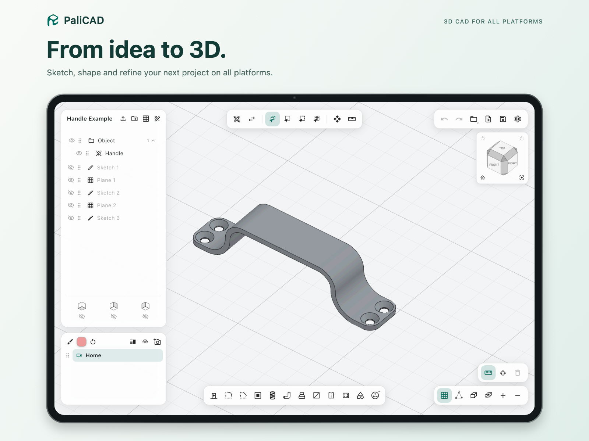
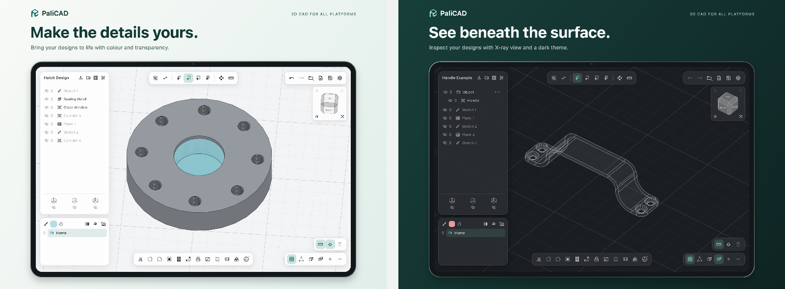

# PaliCAD

**Sketch, shape, and refine your next project.**

PaliCAD is a direct-modelling 3D CAD application powered by the Pali Ijo geometry kernel. Sketch on construction planes, extrude and edit solids, and save your work as `.pali` projects.

## Get PaliCAD

**[Get PaliCAD and support development on Patreon →](https://www.patreon.com/c/BraydenNilsen)**

Visit [palicad.com](https://palicad.com) for product information and platform availability.

This public repository hosts PaliCAD's project information and the **Pali Ijo kernel source**. The PaliCAD application source is no longer distributed through this repository. Visit Patreon for current PaliCAD releases and membership details.



## Design with PaliCAD

- Sketch with lines, circles, rectangles, polygons, splines, and construction planes.
- Extrude, combine, subtract, fillet, chamfer, hollow, and thread solids.
- Inspect and edit faces, edges, and objects.
- Work with CAD and mesh formats including STEP, STL, 3MF, and DXF.



## Pali Ijo kernel

[Pali Ijo](packages/pali_ijo/) is a standalone Dart CAD kernel with boundary representation (BREP), mesh operations, measurements, and CAD file interchange. It can be used independently of the PaliCAD application and Flutter.

**[Read the kernel documentation and API examples →](packages/pali_ijo/README.md)**

## Browser CAD workspace

The [`web/`](web/) folder contains a browser CAD workspace powered by the Pali Ijo geometry kernel. It supports mouse-drawn rectangle/circle sketches, reference-image import and scale/position adjustment, mouse-traced closed sketch outlines, extrusion of traced profiles and rectangles with through-holes, and mouse-drawn box, sphere, cylinder, cone, torus, prism and pyramid primitives; solid union, subtraction and intersection; translation; convex-edge fillets and chamfers; mass-property inspection; native `.pali` project save/open; STEP, STL, 3MF and OBJ import; and per-body STEP, 3MF, STL and OBJ export. Raster reference images (PNG, JPEG and WebP) are embedded in native projects. STEP import adds each supported solid as a separate selectable body while retaining analytic BREP geometry when the kernel can read it. Unsupported STEP surface sets may fall back to a faceted mesh; those parts can be inspected, moved, resized and exported, but do not support analytic booleans, fillets or chamfers. Models are rendered from the kernel's tessellated geometry. It is an early direct-modeling workspace, not yet feature-complete with the PaliCAD application described in the Getting Started guide.

The browser workspace requires Node.js and Dart 3.9.2 or later. Add the Dart SDK's `bin` folder to `PATH`, or set `DART_SDK` to the SDK installation folder. From PowerShell:

```powershell
cd web
npm.cmd install
npm.cmd run dev
```

The first development or production build compiles the browser WebAssembly kernel; keep Dart available on `PATH` when using `npm.cmd run dev` or `npm.cmd run build`. Open the local URL printed by Vite. `.pali` files save this workspace's multi-body projects; kernel exports preserve STEP geometry where supported, while 3MF, STL and OBJ are mesh exports. CAD operations remain subject to the kernel's documented geometry and boolean limitations.

To work with the kernel, install Dart 3.9.2 or a compatible later Dart 3 release, then run:

```sh
git clone https://github.com/braydennilsen/PaliCAD.git
cd PaliCAD/packages/pali_ijo
dart pub get
dart test
```

The kernel documentation also covers its command-line interface, browser build, supported operations, and current limitations.

## Licensing

Pali Ijo is [MIT licensed](packages/pali_ijo/LICENSE). Its [third-party notices](packages/pali_ijo/THIRD_PARTY_NOTICES.txt) and accompanying licenses are included in the package.

The kernel's MIT license does not apply to the PaliCAD application, branding, or promotional images. The [PaliCAD application license](LICENSE) is retained for reference; application source is not included here. Promotional images and branding are copyright © 2026 Brayden Nilsen, all rights reserved.

## Support development

[Patreon](https://www.patreon.com/c/BraydenNilsen) · [Ko-fi](https://ko-fi.com/braydennilsen) · [PaliCAD website](https://palicad.com)
