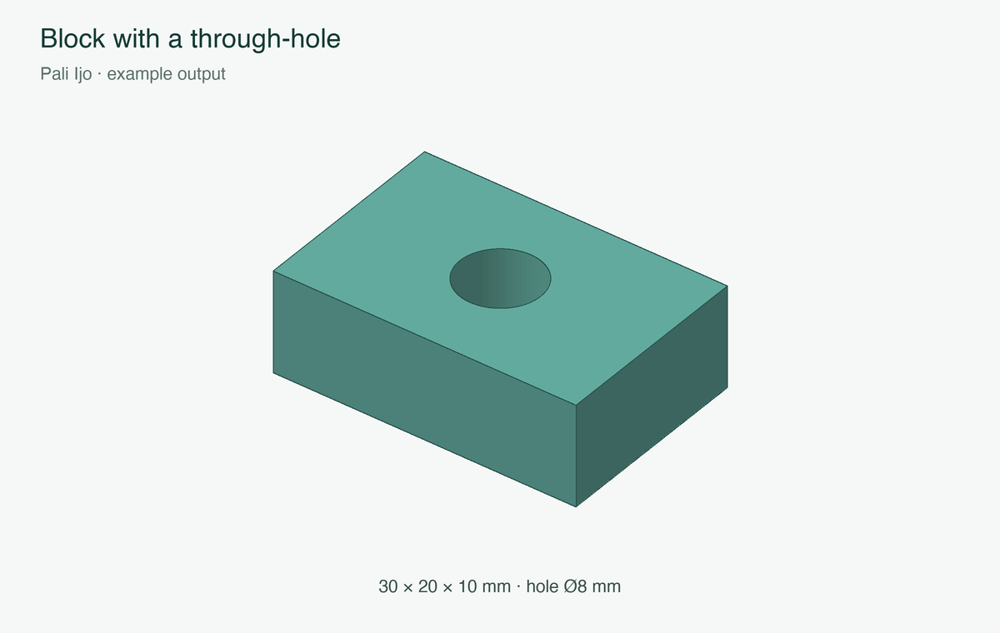
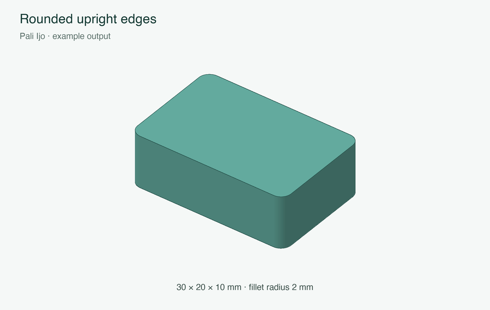
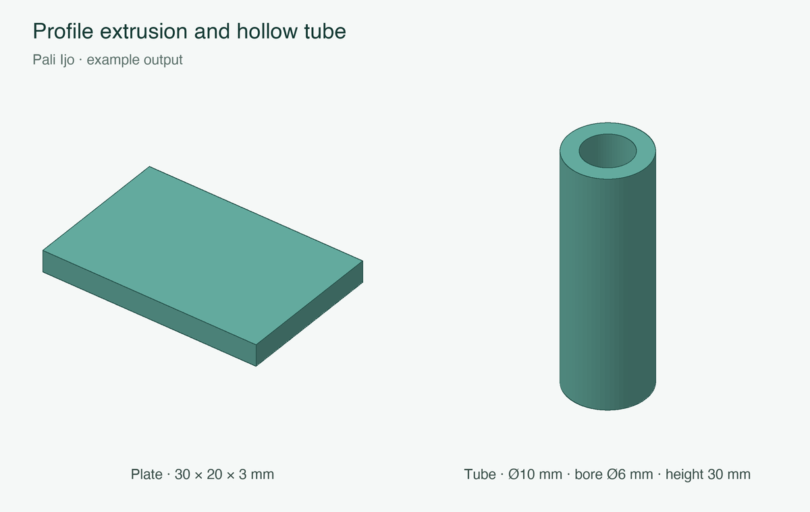
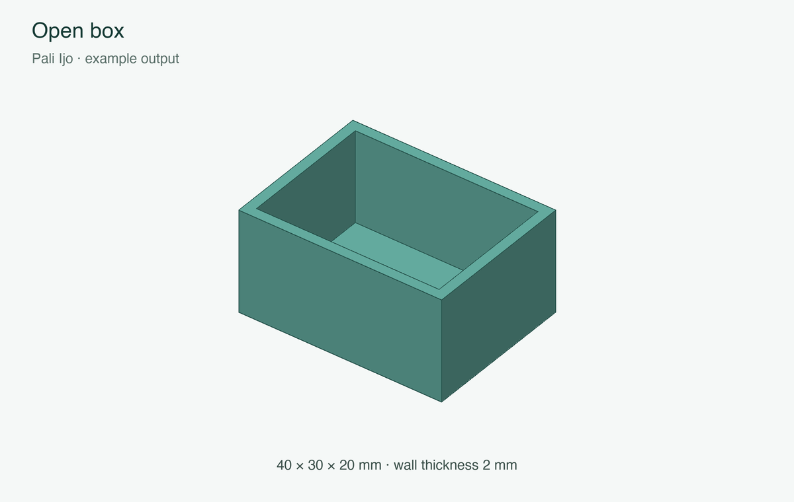
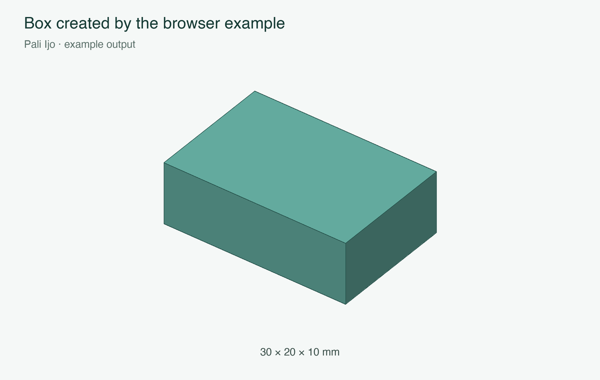

# Pali Ijo

Pali Ijo is a Dart BREP CAD kernel. It uses boundary representation (BREP) to describe a 3D object through its faces, edges and vertices. It provides tools to create and modify these objects, a tessellation layer that turns them into triangles for 3D display, and methods for importing and exporting models.

The kernel is written in Dart and can be used independently of Flutter. PaliCAD uses it for its modelling operations. You can also use it directly in a Dart program, run its command-line tool from another language, or build its WebAssembly entry point for a browser.

## Contents

- [Features](#features)
- [Use from Dart](#use-from-dart)
- [Dart API guide](#dart-api-guide)
- [Build and use the CLI](#build-and-use-the-cli)
- [CLI command reference](#cli-command-reference)
- [Face and edge selectors](#face-and-edge-selectors)
- [File formats](#file-formats)
- [Browser build](#browser-build)
- [Current limits](#current-limits)
- [License](#license)

## Features

### Creating and editing solids

- Create boxes, cylinders, cones, truncated cones, spheres, tori, regular prisms and pyramids.
- Extrude planar profiles, profiles with holes, and existing planar faces. Profiles can include straight lines, circular arcs, ellipses and supported spline curves.
- Join solids, subtract one solid from another, or keep their intersection.
- Round edges with fillets and bevel them with chamfers. Chamfers support equal distances, two different distances, or a distance and an angle.
- Hollow a solid with selected openings or an enclosed cavity.
- Create pipes and tubes along paths, with cylindrical runs and rounded bends.
- Loft between parallel planar sections, including paired holes in two-section lofts.
- Cut external and internal threads, with left- or right-hand winding, multiple starts, partial lengths, taper and gradual runouts.
- Slice solids with a plane and separate disconnected bodies while keeping enclosed cavities with their surrounding bodies.
- Translate, rotate through an affine transform, mirror and scale geometry, including different scale factors on each axis.

### Display, selection and measurement

- Tessellate BREP solids at draft, standard or fine quality for display and mesh export.
- Keep face and edge identifiers on display meshes so an application can relate selections to the BREP.
- Select faces and edges by position, direction, geometry, size, index or their association with earlier modelling operations.
- Measure volume, surface area, centre of mass at uniform density, bounds and sphericity.
- Check closure, clean up topology and repair supported mesh defects.

### Mesh tools and integration

- Create mesh revolutions, lathes, profile sweeps, helical sweeps and skins between rings.
- Perform mesh booleans, offsets, Minkowski sums and differences, fillets, chamfers, hollows, threads and plane cuts.
- Weld vertices, triangulate polygons, merge coplanar faces, remove degenerate faces, stitch junctions, seal boundaries and split connected components.
- Construct convex hulls and check convexity.
- Save BREP geometry, topology and source associations in JSON.
- Read and write STEP, STL, OBJ and 3MF.
- Pack solids and meshes into data suitable for Dart isolates.
- Run operations through a CLI with file input, shell pipelines and JSON reports.
- Access the command interface from JavaScript through a WebAssembly build.

Support depends on the geometry involved. The [current limits](#current-limits) section covers the main restrictions.

## Use from Dart

Use Dart 3.9.2 or later within the Dart 3 series. Add Pali Ijo and `vector_math` to your application's `pubspec.yaml`, adjusting the local path to the kernel folder:

```yaml
dependencies:
  pali_ijo:
    path: ../PaliCAD/packages/pali_ijo
  vector_math: ^2.1.4
```

Run `dart pub get`, then import both packages. Flutter applications can use the same dependencies with `flutter pub get`.

### Make a part, display it and save it

This complete example makes a block with a through-hole, generates a display mesh, measures the part and writes JSON, STEP and STL files. The previews below are rendered from the examples' output meshes:

```dart
import 'dart:io';

import 'package:pali_ijo/pali_ijo.dart';
import 'package:vector_math/vector_math_64.dart';

void main() {
  final block = BrepPrimitives.box(30, 20, 10);
  final drill = BrepPrimitives.cylinder(
    origin: Vector3(15, 10, -1),
    axis: Vector3(0, 0, 1),
    radius: 4,
    height: 12,
  );
  final part = IjoOps.booleanSolid(block, drill, IjoOps.subtractOp);

  // Keep this mesh for your viewer, alongside the BREP used for editing.
  final displayMesh = IjoOps.tessellateClosed(
    part,
    tessellation: MeshTessellation.fine,
  );
  print('Display triangles: ${displayMesh.faces.length}');

  final properties = IjoMeasure.ofSolid(part);
  print('Volume: ${properties.volume} mm³');
  print('Surface area: ${properties.surfaceArea} mm²');

  final document = IjoDocument.solid(part, name: 'Drilled block');
  File('part.json').writeAsStringSync(document.encode(pretty: true));
  File('part.step').writeAsBytesSync(IjoIo.encode(document, IjoFormat.step));
  // Export the fine-quality mesh explicitly.
  File('part.stl').writeAsBytesSync(IjoStl.write(displayMesh));

  final reopened = IjoDocument.decode(File('part.json').readAsStringSync());
  print('Reopened BREP faces: ${reopened.solid.faces.length}');
}
```



PaliCAD and the CLI use millimetres for lengths. Use a consistent unit throughout your Dart models. CLI angles are in degrees; Dart geometry methods generally take radians, except parameters explicitly named `angleDegrees`.

### Round selected edges

```dart
final block = BrepPrimitives.box(30, 20, 10);
final uprightEdges = BrepEdgeSelect.linear(
  direction: Vector3(0, 0, 1),
).resolve(block);
final rounded = IjoOps.filletSolid(
  block,
  uprightEdges,
  radius: 2,
  inverse: false,
);
```



### Extrude a profile and make a tube

```dart
final plate = BrepExtrude.polygon(
  [Vector3(0, 0, 0), Vector3(30, 0, 0),
   Vector3(30, 20, 0), Vector3(0, 20, 0)],
  Vector3(0, 0, 3),
);

final tube = BrepPipe.run(
  [Vector3(0, 0, 0), Vector3(0, 0, 30)],
  radius: 5,
  innerRadius: 3,
);
```



## Dart API guide

The main import, `package:pali_ijo/pali_ijo.dart`, exposes the modelling, mesh, selection, measurement and file APIs. The following guide covers the main entry points. Linked source files provide the full method signatures and lower-level helpers.

### Solids, curves and surfaces

[`BrepSolid`](lib/src/brep/solid.dart) stores `vertices`, `edges` and `faces`. Each face has a surface and boundary loops; each loop refers to shared edges and their direction. `BrepBuilder` provides `vertex`, `edge`, `face` and `build` methods for constructing this structure directly.

[`BrepCurve` and `BrepSurface`](lib/src/brep/geom.dart) provide evaluation and JSON serialization. Geometry types include lines, circles, ellipses, helices, planes, cylinders, cones, spheres, tori, ruled surfaces, rational B-spline curves and surfaces, affine transformations, and supported surface-intersection curves. Surface methods include `evaluate`, `normalAt`, `parameters` and `closestPoint`.

[`BrepOrigin` and `BrepProvenance`](lib/src/brep/provenance.dart) record where faces and edges came from. These associations let selections follow geometry through supported edits. [`BrepClassify`](lib/src/brep/classify.dart) and [`BrepIntersect`](lib/src/brep/intersect.dart) provide lower-level point classification and geometry-intersection helpers.

### Primitives

[`BrepPrimitives`](lib/src/brep/primitives.dart) returns `BrepSolid` objects:

- `box(dx, dy, dz)`: sizes along X, Y and Z, with one corner at the origin.
- `cylinder(origin:, axis:, radius:, height:)`: base centre, axis, radius and height.
- `cone(origin:, axis:, radius:, height:)`: base centre, axis, base radius and height.
- `frustum(origin:, axis:, radius:, topRadius:, height:)`: a cone with two end radii.
- `sphere(center:, radius:)`: centre and radius.
- `torus(center:, axis:, majorRadius:, minorRadius:)`: ring centre, axis, ring radius and tube radius.
- `prism(diameter:, height:, sides:)` and `pyramid(diameter:, height:, sides:)`: regular polygons, with diameter measured across their vertices.
- `fromMesh(mesh)`: construct BREP topology from mesh faces. Recognition helpers include `tryAabbBox`, `tryCylinderFromMesh`, `tryCylinderFromRing` and `tryPlanarSolid`.

### Modelling operations

[`IjoOps`](lib/src/ops/ops.dart) groups the common operations:

- `booleanSolid(a, b, op)`: use `unionOp`, `subtractOp` or `intersectOp`.
- `filletSolid(solid, edgeIds, radius:, inverse:)`: round selected edges. `inverse` selects the inverse blend construction.
- `chamferSolid(solid, edgeIds, distance, options:)`: bevel selected edges. `ChamferOptions` takes `mode`, `distance2` and `angleDegrees`; modes are `defaultMode`, `twoDistance` and `setAngle`.
- `hollowSolid(solid, openingFaces, openingNormal, wallThicknessMm:)`: offset supported faces to create walls. Pass an empty face list for an enclosed cavity.
- `sliceBrep(solid, origin, normal)`: return the pieces made by a cutting plane.
- `splitBrep(solid)`: return separate bodies, keeping cavity shells with their enclosing body.
- `loftPreferSolid(sections, closed: false, holes: [])`: join `SweepProfile` sections. `holes` contains pairs of inner profiles for a two-section loft. The result has `.solid` and `.mesh` fields. Closed lofts are currently unsupported.
- `pipePreferSolid(path, outerRadius:, innerRadius:, closed: false, sides: 32, tessellation:)`: return a BREP pipe and display mesh. `tessellation` controls display density; `sides` is currently unused on this BREP path.
- `booleanPreferSolid` and `hollowPreferSolid`: integration helpers that accept the application's stored BREP and mesh data and return both representations when available.

[`BrepExtrude`](lib/src/brep/extrude.dart) provides `polygon`, `profile`, `polygonWithHoles`, `profileWithHoles`, `fromCurves` and `fromFace` constructors. Profiles use a ring and an extrusion direction; hole variants also take inner rings. `tryMovePlanarFace` moves a supported face, and `attachFromFace` joins an extrusion to an existing solid.

[`BrepPipe.run`](lib/src/brep/pipe.dart) takes a path, required `radius`, optional `innerRadius` and `closed: false`. `BrepLoft.sections` takes ordered planar rings and optional pairs of hole rings. These constructors return BREPs directly.

[`BrepXform`](lib/src/brep/xform.dart) provides `translate(solid, displacement)`, `mirror(solid, origin, normal)`, `scaleAbout(solid, center, scale)` and `affine(solid, transform)`. `BrepAffineTransform` supports rotation, shear and other nonsingular affine mappings. `map` accepts a point-mapping function for supported transformations. `materializeSplineBody` converts supported transformed geometry into spline form.

### Threads

[`BrepThreads.apply`](lib/src/brep/threads.dart) takes a body and these named parameters:

- Required: `origin`, `axis`, `radius`, `pitch`, `axisZMin`, `axisZMax`, `length`.
- Optional: `taper: 0`, `runoutLength: 0`, `internal: false`, `rightHand: true`, `starts: 1`, `fromEndA: true`, `fromEndB: false`.

The axial limits are distances from `origin` along the normalized axis. End A is the lower limit; end B is the upper limit. Select both ends for two threaded regions, or set both end flags to `false` for the full interval. A positive `length` is required in each case.

For external threads, `radius` is the major radius. For internal threads it is the basic minor radius: major radius minus `ThreadForm(pitch: pitch, internal: true).depth`. Pitch is the spacing between adjacent crests; lead is `pitch * starts`. Taper specifies radial change per unit of axial distance. A runout gradually reduces the groove at each end and must fit twice within each selected region.

`BrepThreads.cutter` creates an individual thread cutter; `subtract` provides a convenience operation without exact end clipping. [`ThreadForm`](lib/src/thread/form.dart) supplies the 60-degree profile dimensions and axial-region calculations. Print clearance and manufacturing tolerances are choices for the calling application.

### Tessellation and measurement

`IjoOps.tessellate(solid, tessellation:)` creates a mesh. `tessellateClosed` also checks BREP closure and requires a closed display mesh. `tessellateKeep` can retry at draft quality if its first closed-mesh attempt fails. Each accepts `MeshTessellation.draft`, `.standard` or `.fine`; the default is `.standard`.

[`MeshData`](lib/src/mesh/mesh_data.dart) contains vertices, faces and optional source face/edge identifiers. Retain the `BrepSolid` alongside its mesh when subsequent edits need BREP geometry. `IjoDocument.mesh` stores a mesh; `IjoDocument.solid` stores the BREP and provides a mesh on demand.

[`IjoMeasure.ofSolid`](lib/src/measure/properties.dart) measures a BREP, while `IjoMeasure.of` and `ofMesh` measure a mesh. The result contains `volume`, `surfaceArea`, `centroid`, `bounds`, `sphericity` and `isExact`. Convenience methods expose individual measurements. `IjoBounds` provides `min`, `max`, `size`, `center`, `diagonal` and spatial queries.

`isExact` indicates that measurement used supported analytic surface domains. Numerical integration still has finite error. When a surface domain cannot be measured that way, the kernel measures the complete tessellation and sets `isExact` to `false`.

### Selection and cleanup

[`BrepFaceSelect` and `BrepEdgeSelect`](lib/src/select/brep_selectors.dart) resolve to BREP indices. They support selection by indices, geometry type, direction, bounds and modelling origin, plus `and`, `or` and `not`. Face selectors include `planar`, `cylindrical`, `extreme`, `created`, `fromOriginal`, `withOrigin` and `descendedFrom`. Edge selectors include `circular`, `linear`, `convex`, `concave`, `longerThan`, `ofFace`, `created` and `fromOriginal`.

[`FaceSelect` and `EdgeSelect`](lib/src/select/selectors.dart) provide corresponding mesh selections. [`MeshFaceRegions`](lib/src/mesh/mesh_regions.dart), [`EdgeGeometry`](lib/src/ops/edge_geometry.dart) and [`LoopGeometry`](lib/src/ops/loop_geometry.dart) help applications work with connected face regions, boundaries, normals and edge selections.

[`BrepHeal.run`](lib/src/brep/heal.dart) cleans supported topology. `topologyIsClosed` checks shared-edge closure. The mesh cleanup helpers below work on tessellations. Closure checks do not establish that arbitrary geometry is free of self-intersections.

### Mesh construction and editing

[`SweepProfile`](lib/src/sweep/profile.dart) provides `closed`, `of`, `circle` and `rectangle` constructors, with `ProfileLine` and `ProfileArc` segments. [`IjoRevolve`](lib/src/sweep/revolve.dart) provides `run` and `lathe`. Their current return type is `MeshData`.

[`IjoSweep`](lib/src/sweep/sweeps.dart) provides `path`, `withFrames`, `linear`, `pipe`, `tube`, `loft`, `helixPath` and `helix`, along with explicit `pipeMesh`, `loftMesh` and `helixMesh` variants. These methods return meshes or path points. [`IjoSkin` and `PathFrames`](lib/src/sweep/skin.dart) connect rings and calculate coordinate frames along a path.

The mesh operations in `IjoOps` include `boolean`, `minkowskiSum`, `minkowskiDifference`, `offsetMesh`, `filletEdges`, `chamferEdges`, `hollow`, `threads`, `threadCutters`, `threadCutterMeshes`, `slice`, `sliceParts` and `splitSolids`. `revolve`, `lathe`, `sweep`, `loft`, `loftSolid`, `pipe` and `pipeSolid` also return meshes; use the BREP constructors or `*PreferSolid` methods when you need the corresponding solid where supported.

[`MeshKit`](lib/src/mesh/mesh_kit.dart) exposes:

- Construction: `cylinder`, `icosphere`, `pipe`, `trianglePrism`, `extrudeTriangles`, `sweepPolygon`, `sweepPolygonWithHoles`, `revolvePolygon`, `extrudeRegion`, `pocketRegion`, `convexHull`.
- Editing: `clone`, `combine`, `triangulate`, `invert`, `transformVertices`, `scaleAbout`, `mirror`, `fitImported`.
- Cleanup: `weld`, `dropDegenerateFaces`, `unifyCoplanarFaces`, `splitTJunctions`, `stitchTJunctions`, `sealSolid`, `preserveClosed`.
- Inspection and splitting: `signedVolume`, `isClosedSolid`, `openBoundaryEdgeCount`, `isConvex`, `connectedComponents`, `decompose`, `sliceParts`.

### Saving, background work and logging

`IjoDocument.solid(solid, name:)` and `IjoDocument.mesh(mesh, name:)` wrap one body. Use `encode(pretty:)` / `decode(text)` for JSON strings, or `toJson` / `fromJson` for maps. `BrepSolid` also provides `toJson` / `fromJson` directly.

[`PackedBrep`](lib/src/brep/pack.dart) and [`PackedMesh`](lib/src/mesh/packed_mesh.dart) provide data representations for transfer to worker isolates. Kernel modelling calls are synchronous; the host application manages background execution, cancellation and time limits.

[`IjoLog`](lib/src/ijo_log.dart) exposes `enabled`, `verbose`, `sink`, `last`, `recent` and file-logging helpers. It can record the operation being performed and send messages to an application's own logger.

## Build and use the CLI

Run the following commands from this package folder, `packages/pali_ijo`. The Dart SDK is required to build or run from source. A compiled native executable can run independently of the SDK.

### Run from source

```sh
dart pub get
dart run bin/pali_ijo.dart --help
dart run bin/pali_ijo.dart box --size 30,20,10 --out block.json
```

### Build a native executable

On macOS or Linux:

```sh
dart pub get
mkdir -p build
dart compile exe bin/pali_ijo.dart -o build/pali_ijo
./build/pali_ijo --help
```

On Windows, in PowerShell:

```powershell
dart pub get
New-Item -ItemType Directory -Force build | Out-Null
dart compile exe bin/pali_ijo.dart -o build/pali_ijo.exe
.\build\pali_ijo.exe --help
```

Build on the operating system and architecture where you intend to run the executable. The commands below use `pali_ijo` as a short name: add the executable's folder to your `PATH`, or replace it with `./build/pali_ijo` or `.\build\pali_ijo.exe`.

### Create, edit and export

This example creates an open box and exports it for printing:

```sh
pali_ijo box --size 40,30,20 --out block.json
pali_ijo hollow --in block.json --thickness 2 --faces top --out tray.json
pali_ijo export --in tray.json --out tray.stl
pali_ijo measure --in tray.json --json
```



Commands can also pass JSON through a pipe. In a POSIX shell:

```sh
pali_ijo box --size 40,30,20 \
  | pali_ijo hollow --thickness 2 --faces top \
  | pali_ijo export --out tray.3mf
```

To subtract a cylinder from a block:

```sh
pali_ijo box --size 30,20,10 --out block.json
pali_ijo cylinder --radius 4 --height 12 --origin 15,10,-1 --out drill.json
pali_ijo boolean --in block.json --op subtract --with drill.json --out part.json
pali_ijo export --in part.json --out part.step
```


### Call the CLI from Python

```python
import subprocess


def run(*args, source=None):
    result = subprocess.run(
        ["pali_ijo", *args], input=source,
        text=True, capture_output=True, check=True,
    )
    return result.stdout


block = run("box", "--size", "40,30,20")
tray = run("hollow", "--thickness", "2", "--faces", "top", source=block)
run("export", "--out", "tray.stl", source=tray)
print(run("measure", "--json", source=tray))
```


Keep JSON between modelling steps to retain the body's representation. Export to a mesh format when you need a mesh file.

## CLI command reference

All 30 commands are listed below. Required options are marked **required**. Other options are optional; defaults are given where applicable.

### Common options and value formats

- `--help`, `-h`: show general or command-specific help, for example `pali_ijo hollow --help`. `pali_ijo help hollow` also works.
- `--verbose`, `-v`: write diagnostic messages to stderr. Available globally and on each command.
- `--in FILE`, `-i FILE`: read input from a file. Available on editing, query and export commands. Without it, input comes from stdin.
- `--out FILE`, `-o FILE`: write a model to a file. Available on creation, editing and export commands. The filename extension selects the format. Without it, creation and editing commands write JSON to stdout.
- `--name TEXT`: set the output document name. Available wherever `--out` is available.
- `--json`: query commands (`measure`, `select`, `info`) report JSON instead of text. These commands have no `--out` or `--name`; redirect stdout if you want a report file.

Vectors use `x,y,z`. Directions also accept `x`, `y`, `z`, `-x`, `-y`, `-z` and their positive-axis forms. Point lists use semicolons: `"0,0,0;20,0,0;20,10,0"`. Quote lists and selectors containing shell punctuation. For negative values, `--normal=-z` or `--distance=-2` avoids ambiguity with option names.

### Creation commands

These commands create a new body and do not take `--in`.

#### `box`

Create a BREP box with a corner at the origin.

- `--size X,Y,Z`, `-s`: **required**; all three dimensions must be positive.

#### `cylinder`

Create a BREP cylinder.

- `--radius MM`, `-r`: **required**, positive.
- `--height MM`: **required**, positive.
- `--origin X,Y,Z`: base centre; default `0,0,0`.
- `--axis DIR`: height direction; default `z`.

#### `sphere`

Create a BREP sphere.

- `--radius MM`, `-r`: **required**, positive.
- `--center X,Y,Z`: default `0,0,0`.

#### `cone`

Create a BREP cone with its tip along the axis.

- `--radius MM`, `-r`: **required**, positive base radius.
- `--height MM`: **required**, positive.
- `--origin X,Y,Z`: default `0,0,0`.
- `--axis DIR`: default `z`.

#### `torus`

Create a BREP ring.

- `--major MM`: **required**, positive ring radius.
- `--minor MM`: **required**, positive tube radius, smaller than `--major`.
- `--center X,Y,Z`: default `0,0,0`.
- `--axis DIR`: default `z`.

#### `prism` and `pyramid`

Create a regular BREP prism or pyramid along Z. Both commands take the same options:

- `--diameter MM`, `-d`: **required**, positive diameter across the base vertices.
- `--height MM`: **required**, positive.
- `--sides N`, `-n`: **required**, at least `3`.

#### `lathe`

Revolve a radius/height outline. The current output is a mesh.

- `--outline "R,H;R,H;..."`, `-l`: **required**, at least three points.
- `--origin X,Y,Z`: default `0,0,0`.
- `--axis DIR`: default `z`.
- `--angle DEGREES`: default `360`.

#### `revolve`

Revolve a closed planar profile around an axis in the same plane. The current output is a mesh.

- `--profile "X,Y,Z;..."`, `-p`: **required**, at least three points.
- `--origin X,Y,Z`: point on the axis; default `0,0,0`.
- `--axis DIR`: default `z`.
- `--angle DEGREES`: default `360`.

#### `sweep`

Carry a profile along a polyline to create a mesh.

- `--profile "X,Y,Z;..."`, `-p`: **required**, at least three profile points.
- `--path "X,Y,Z;..."`: **required**, at least two path points.
- `--twist DEGREES`: total twist; default `0`.
- `--closed`: join the path's ends; default off.

#### `pipe`

Create a BREP pipe or hollow tube along a path.

- `--path "X,Y,Z;..."`: **required**, at least two points.
- `--radius MM`, `-r`: **required**, positive outer radius.
- `--inner MM`: positive inner radius smaller than the outer radius. Omit for a solid pipe.
- `--closed`: join the path's ends; default off.
- `--sides N`, `-n`: default `32`, minimum `3`. Currently validated but unused by the BREP construction and display tessellation.

#### `loft`

Create a BREP through ordered parallel planar sections.

- `--section "X,Y,Z;..."`, `-s`: **required**, repeat at least twice. Each section has at least three points.
- `--closed`: accepted by the parser, but the current BREP implementation rejects closed lofts.

### Editing commands

These commands take `--in` or stdin and support the common output options.

#### `boolean`

Join two bodies, subtract the second, or keep their intersection.

- `--with FILE`, `-w`: **required**, second body.
- `--op union|subtract|intersect`: default `union`.

Two BREP inputs produce a BREP; two mesh inputs produce a mesh. Mixed inputs require explicitly converting the BREP with `tessellate` first.

#### `minkowski`

Expand or erode a shape using another shape as the tool. Produces a mesh.

- `--with FILE`, `-w`: **required**, tool body.
- `--op sum|difference|diff`: default `sum`; `diff` means `difference`.

#### `offset`

Grow or shrink a shape. Produces a mesh.

- `--radius MM`, `-r`: **required**; positive grows, negative shrinks.

The implementation includes planar face-offset paths. The result should not be assumed to have a round blend at every corner.

#### `fillet`

Round selected edges, preserving the input's BREP or mesh representation.

- `--radius MM`, `-r`: **required**, positive.
- `--edges SPEC`, `-e`: default `convex`.
- `--inverse`: request the inverse blend construction; default off.

#### `chamfer`

Bevel selected edges with equal setbacks, preserving the input's representation. Perpendicular faces produce a 45-degree bevel.

- `--distance MM`, `-d`: **required**, positive setback.
- `--edges SPEC`, `-e`: default `convex`.

Two-distance and angle-based chamfers are available through the Dart API.

#### `hollow`

Create a shell, preserving the input's representation.

- `--thickness MM`, `-t`: **required**, positive wall thickness.
- `--faces SPEC`, `-f`: opening faces; default `top`.
- `--closed`: create a sealed cavity and ignore `--faces`; default off.

#### `extrude`

Push or pull existing planar faces, preserving the input's representation.

- `--distance MM`, `-d`: **required**, nonzero distance along the outward face normal. Negative values move inward.
- `--faces SPEC`, `-f`: default `top`.

#### `threads`

Cut threads into a shaft or bore, preserving the input's representation.

- `--pitch MM`, `-p`: **required**, positive spacing between crests.
- `--diameter MM`, `-d`: **required**, positive nominal major diameter.
- `--origin X,Y,Z`: point on the axis; default `0,0,0`.
- `--axis DIR`: default `z`.
- `--from whole|a|b|both`: default `whole`. A is the lower axial end; B is the upper end.
- `--length MM`, `-l`: positive threaded length from the selected end; defaults to the body's full axial extent. Ignored with `--from whole`.
- `--starts N`: default `1`, positive integer.
- `--internal`: thread a bore; default off.
- `--left-hand`: use left-hand winding; default off.
- `--taper RATIO`: radial change per axial unit; default `0`. Requires BREP input.
- `--runout MM`: gradual groove transition at each end; default `0`. Requires BREP input and sufficient room within the threaded region.

#### `scale`

Scale a body around a fixed point, preserving its representation.

- `--factor NUMBER`, `-f`: positive uniform factor; **required unless `--by` is supplied**.
- `--by X,Y,Z`: per-axis factors; each must be nonzero. Overrides `--factor`.
- `--about X,Y,Z`: fixed point; defaults to the body's centroid.

#### `mirror`

Reflect a body through a plane, preserving its representation.

- `--normal DIR`, `-n`: **required**, plane normal.
- `--origin X,Y,Z`: point on the plane; default `0,0,0`.

#### `translate`

Move a body, preserving its representation.

- `--by X,Y,Z`, `-b`: **required**, displacement.

#### `slice`

Cut with a plane and keep one resulting piece, preserving the input's representation.

- `--normal DIR`, `-n`: **required**, plane normal.
- `--origin X,Y,Z`: point on the plane; default `0,0,0`.
- `--part N`, `-p`: zero-based index of the piece to keep. Omit to keep the largest by mesh volume.

#### `heal`

Clean up supported BREP topology or merge coplanar mesh faces. Has no additional options. Writes the before/after face counts to stderr.

#### `tessellate`

Convert a BREP document to a mesh document, or pass through an existing mesh.

- `--quality draft|standard|fine`, `-q`: default `standard`. **Currently accepted but not applied:** the command uses the document's default mesh. Use `IjoOps.tessellate` with `MeshTessellation.fine` in Dart to choose a higher density.

### Query and export commands

#### `measure`

Report volume, surface area, centroid and bounds. Text output also includes size, sphericity and face count. Uses BREP measurement where supported and mesh measurement otherwise. Supports `--in`, `--verbose` and `--json`; no additional options.

#### `select`

Report matching mesh face indices and edge vertex pairs. Supports `--in`, `--verbose` and `--json`.

- `--faces SPEC`, `-f`: face selection.
- `--edges SPEC`, `-e`: edge selection.

Supply at least one selection. This query currently selects the display mesh even for BREP input, so its reported indices can differ from the BREP indices used by editing commands.

#### `info`

Report display-mesh vertex count, face count, closure and volume. Supports `--in`, `--verbose` and `--json`. Its current `kind` field is always `mesh`, including when the input document contains a BREP. Inspect the saved JSON's `kind` field to identify the stored representation.

#### `export`

Write a body in another format. Supports the common input, output, name and verbose options.

- `--format json|step|3mf|obj|stl|stla`, `-f`: override the output extension. Required when omitting `--out`.

With `--format` and no output filename, the encoded file is written to stdout. Use `--out` for binary files when calling from a text-oriented shell or subprocess wrapper.

### Errors and diagnostic output

Successful commands return exit code `0`. Errors go to stderr with a nonzero code: `64` for usage or argument errors, `65` for malformed data, `66` for file-access errors, and `70` for geometry failures or other execution errors.

`-v` enables detailed operation logging. Native runs also accept `IJO_DEBUG=1` for basic logging, `IJO_DEBUG=2` for detailed logging and `IJO_DEBUG_FILE=path` to append logs to a file. The last recorded operation can help locate a failure.

## Face and edge selectors

Quote compound expressions, for example `--faces "planar+!top"`. Use `+` for intersection, `/` for union and `!` for negation. Intersection is evaluated before union. Parentheses are not supported. Within selectors, use `z` rather than `+z`, because `+` is also the combination operator.

### Faces

- `all`, `none`: select all faces or none.
- `0,2,5` or `indices:0,2,5`: zero-based indices.
- `planar`, `plane`, `flat`: planar faces.
- `normal:DIR`: faces aligned with a direction.
- `top`, `bottom`: extreme faces along +Z or −Z.
- `extreme:DIR`: faces furthest along a direction.
- `within:MIN;MAX`: faces contained in a bounding box, such as `"within:0,0,0;10,10,10"`.
- On BREPs: `cylinder`/`cylindrical`, `sphere`/`spherical`, `cone`/`conical`, `torus`/`toroidal` select the named surface type; `created` or `created:OP` selects generated faces.
- On meshes: the curved-type names above and `curved` all use the general curved-region selection. `created`, `inherited` and `original` currently select all faces because this parser does not resolve their provenance.

### Edges

- `all`, `none`, numeric indices and `indices:...` work as above.
- `line`, `straight`, `linear`: straight edges.
- `linear:DIR`: straight edges aligned with an axis.
- `circle`, `circular`: circular edges.
- `convex`, `concave`: outward or inward corners.
- `longer:MM`: edges longer than a threshold.
- `within:MIN;MAX`: edges inside a bounding box.
- `of-face:SPEC` or `offace:SPEC`: edges belonging to matching faces; for example `of-face:top`.
- On BREPs: `created` and `created:OP` select generated edges.
- On meshes: `ellipse` and `curved` use the same selection as `circular`; provenance terms currently select all edges.

Some built-in help strings advertise additional forms that are not implemented in the CLI parser. Radius suffixes such as `circular:5` and `cylindrical:5` do not filter by radius, and BREP `original:ID` and edge `ellipse` are not supported there. The Dart selectors provide richer type, radius and provenance queries.

## File formats

- **JSON (`.json`):** Pali Ijo's document format. Stores either one BREP or one mesh, plus a name. BREP documents retain curves, surfaces, topology and source associations. Use it for saving ongoing kernel work.
- **STEP (`.step`, `.stp`, `.p21`):** CAD interchange. BREP export supports planes, cylinders, cones, spheres, tori and rational B-spline geometry. Mesh export writes planar faces. More complex native geometry may be converted to splines during export.
- **3MF (`.3mf`):** mesh geometry with shared vertices and declared units.
- **OBJ (`.obj`):** text mesh geometry with shared vertices and polygon faces.
- **STL (`.stl`):** binary triangle mesh on export. Import accepts binary or ASCII STL.
- **ASCII STL (`.stla`):** explicit text STL output.

`IjoIo.encode(document, format)` returns bytes. `IjoIo.decode(bytes, format:, name:)` accepts an explicit format, a filename extension, or recognizable file contents. The CLI uses this same input handling; there is no separate `import` command. For example:

```sh
pali_ijo export --in imported.step --out imported.json
pali_ijo measure --in imported.stl --json
```

For direct STEP access, use `IjoStep.writeSolid`, `readSolid` and `readSolids`. `StepPart.solid` and `IjoStep.writeAll` can write multiple parts. `readSolids` returns all BREP bodies and names; `readAll` is the mesh-oriented reader. The general `IjoIo.decode` path selects the first STEP body and can fall back to the mesh reader. Use `readSolids` when importing all bodies or requiring BREP output.

The individual `IjoStl`, `IjoObj` and `IjoThreeMf` readers and writers are also exported. `ZipArchive` supplies the ZIP handling used by 3MF.

STEP supports enclosed cavities and supported trimmed surfaces. Some curves are approximated by splines for interchange, including helices and certain surface intersections. The checked fitting target for relevant intersection-curve conversions is `1e-7` mm; it is not a universal error guarantee. STEP assembly occurrence graphs are currently unsupported. Older JSON readers may not understand newer geometry types.

## Browser build

The WebAssembly entry point exposes the CLI command interface as `globalThis.paliIjo`. It compiles the browser kernel; operations still depend on the command and geometry limitations described in this guide. From this package folder:

```sh
dart pub get
mkdir -p build/wasm
dart compile wasm wasm/pali_ijo_wasm.dart -o build/wasm/pali_ijo.wasm
```

Serve the generated files over HTTP with a browser that supports WasmGC. The server should use `application/wasm` for the `.wasm` file. Load the generated JavaScript module:

```javascript
import { compileStreaming } from './pali_ijo.mjs';

const compiled = await compileStreaming(fetch('./pali_ijo.wasm'));
const instance = await compiled.instantiate({});
instance.invokeMain();

const box = await globalThis.paliIjo.run(['box', '--size', '30,20,10'], null);
if (box.code !== 0) throw new Error(box.stderr);

const result = await globalThis.paliIjo.run(
  ['export', '--out', 'part.json'], box.stdout,
);
if (result.code !== 0) throw new Error(result.stderr);
const download = new Blob([result.files['part.json']], {
  type: 'application/json',
});
```



`run(argv, stdin)` returns a promise containing `code`, `stdout`, `stderr` and `files`. Written files are `Uint8Array` values keyed by filename. `paliIjo.formats()` lists the format extensions.

The generated loader example above matches the current Dart SDK; older SDKs may generate a different loader interface.

Each call uses a fresh in-memory host. The optional third `run` argument supplies one additional text document at the virtual path `tool.json`, for example `paliIjo.run(['boolean', '--op', 'subtract', '--with', 'tool.json'], baseDocument, toolDocument)`. `runBytes(argv, bytes)` accepts binary stdin for importing STEP, STL, 3MF and OBJ data without converting it through text. Outputs are returned through `files`. Check command failures and rejected promises when integrating operations; some commands may depend on native-runtime behavior that is unavailable in Wasm.

## Current limits

- BREP editing supports a defined set of surface combinations and trims. Complex tangencies, coincident surfaces, singular intersections and some freeform-surface operations can raise `BrepUnsupported`.
- Fillets support planar corners, full circular rims and supported extrusion rims. Arbitrary blends between freeform surfaces, partial-rim endpoint patches and general multi-surface corners remain limited. Some spline blend geometry uses checked numerical fitting.
- Hollowing requires supported face offsets and enough room for the wall thickness. Some curved or blended bodies cannot be hollowed.
- Lofts require suitable parallel planar sections. Closed lofts are unsupported; paired holes are available for two-section lofts through Dart.
- Pipes reject reversing paths and bends that would create singular geometry.
- Thread construction has size and complexity limits. The geometry does not include a manufacturing fit specification.
- `lathe`, `revolve`, `sweep`, `minkowski` and `offset` currently return mesh documents in the CLI. The `tessellate --quality` and `pipe --sides` options currently do not change the generated density.
- Imported meshes retain their mesh representation. Reconstructing a faceted BREP from them preserves the available faces; it does not generally recover the original smooth design surfaces.
- A closed topology or mesh can still have geometric defects. Bounds may be conservative, and measurements and interchange conversions can involve numerical approximation.

## License

Pali Ijo's original code is copyright © 2026 Brayden Nilsen and is licensed under [MIT](LICENSE). You may use, modify, redistribute and sell it, including in commercial and closed-source projects, while retaining the required copyright and license notices. You do not have to publish your changes.

[THIRD_PARTY_NOTICES.txt](THIRD_PARTY_NOTICES.txt) identifies the CSG.js attribution and its scope. Its MIT license is kept in [licenses/CSG.js-LICENSE.txt](licenses/CSG.js-LICENSE.txt). [NOTICES](NOTICES) contains the licenses in the format Flutter uses for its in-app license list.

These permissions apply to Pali Ijo. PaliCAD has its own [license](../../LICENSE). The full license texts govern.
